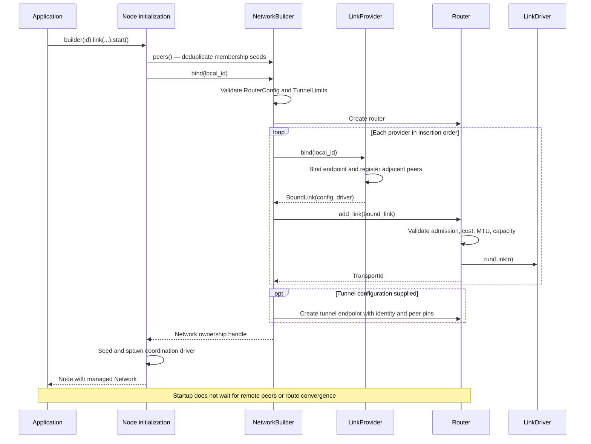
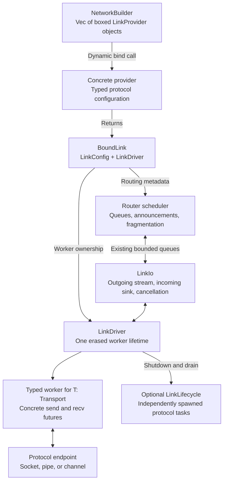
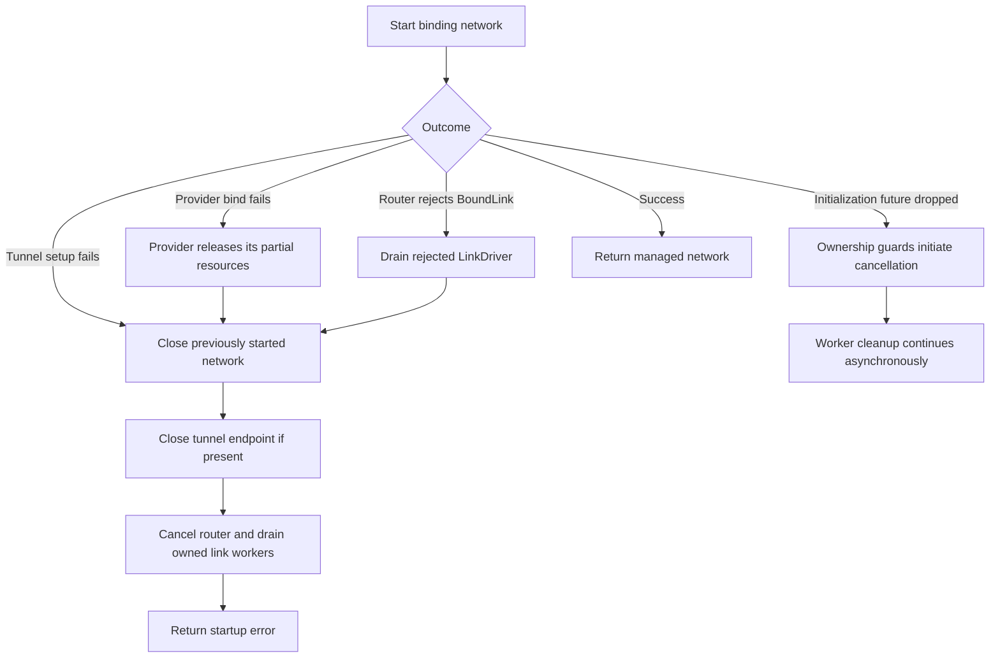
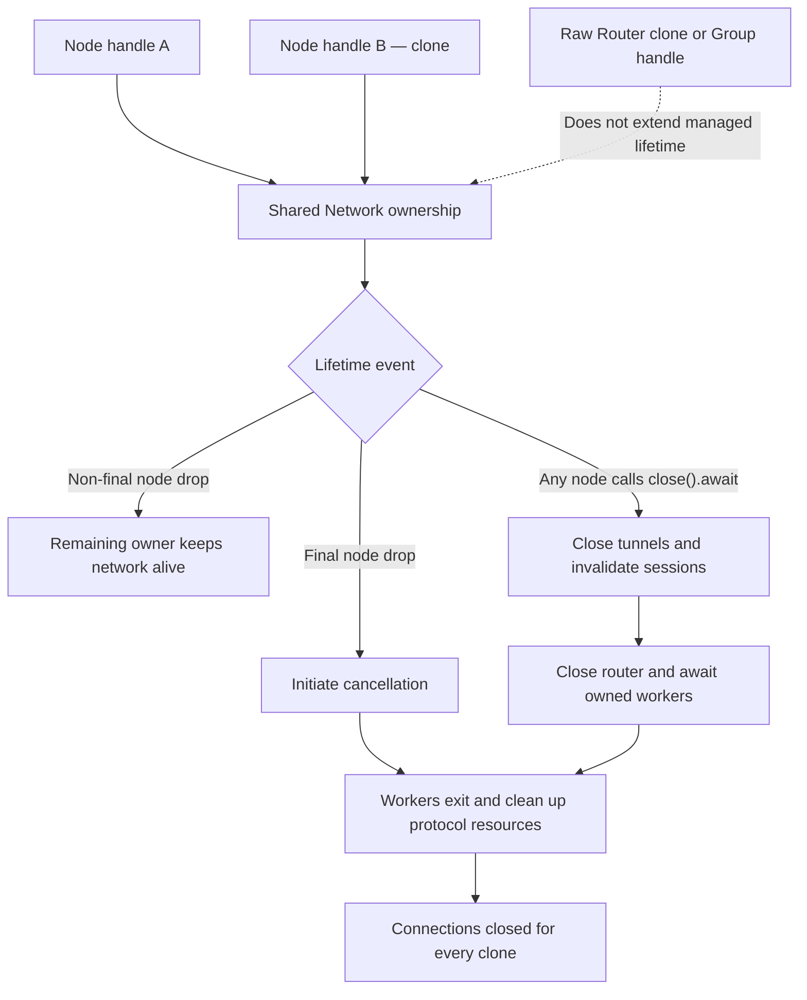

# Link registration and lifecycle

[Documentation index](README.md) · [Previous: architecture](architecture.md) · [Next: routing](routing.md)

All protocols use the same registration contract. Providers own typed addresses,
configuration, binding, and cleanup; the router owns path selection and packet
scheduling. It never needs to know whether a provider uses TCP, IPC, or an
application-defined protocol.

## Dynamic admission contract

Admission is application policy, not a property of a peer's display name or
discovery record. Dynamic links accept a claimed `NodeId` and bounded opaque
credentials through a shared asynchronous admission trait. An explicit open
policy accepts unauthenticated identities; custom policies can reject claims
or require credentials. No key pair is mandatory. Credentials on a plaintext
link are not confidential.

Successful admission binds the accepted identity to one live session. Duplicate
active identities are rejected, not replaced. Disconnect, expiry, cancellation,
and revocation release admission and withdraw paths through that session.
Old-session cleanup must not remove a replacement session. Resource capacity,
credential bounds, handshake deadlines, and bounded pending admission remain
library responsibilities even when the application accepts everyone.

Managed direct TCP reserves `TcpAdmissionConfig::max_pending` handshake slots
**per direction**: inbound and outbound work each have that bound, including
application policy work. Outbound saturation therefore cannot consume the slots
needed to resolve simultaneous inbound dials, even at a one-slot setting. Both
directions retain the configured handshake deadline and shutdown cancellation.

Bootstrap addresses identify initial contacts; they do not enumerate all future
members. Only admitted adjacent peers enter routing. Discovery and forwarded
membership records never independently authorize a new adjacent connection.
Unauthenticated identifiers do not prove continuity after a session ends.

Managed direct TCP retains explicitly registered bootstrap addresses separately
from its learned contacts. Inbound handshake introductions and `learn_peer`
hints share a learned-address cache capped by `TcpAdmissionConfig::max_peers`;
learning refreshes an entry's age and evicts the least recently learned contact
at capacity. Configured addresses take precedence and are neither overwritten
nor evicted by learning. Eviction only removes a future dial hint, not a live
session. Raw trusted TCP endpoints keep an unbounded, last-write-wins address book.

Route discovery supplies a bounded, replaceable set of bootstrap contacts, not
membership assertions. Each group contacts those peers through its own protocol;
an unrelated reachable node is not automatically a member or coordinator.
Periodic bounded exchanges retry lost bootstrap traffic and permit reconnection
despite retained dead-member tombstones.

Already-bound managed TCP and connectivity-backed TCP/UDP adapters expose
`into_bound_link(cost)`, transferring session registry and shutdown lifecycle
together. The connectivity library itself never registers a router link.
It owns live paths, candidate checks, refresh and relay fallback; the protocol
adapter owns transport integration. Do not reconstruct dynamic adapters as
static links from a copied peer list. Custom dynamic
transports attach `SessionRegistry` through `BoundLink::with_sessions`, tag
incoming frames at their producing session, and implement `send_admitted` to
preserve the router-selected generation through queued physical writes.
The default static send drops tagged traffic rather than silently retargeting it.

`SessionRegistry` lifecycle is observable: `subscribe()` publishes neighbor
snapshots, and `is_closed()` / the owned, sticky `closed()` future distinguish a
closed registry from an open one with no peers. `close()` marks the registry
closed before publishing its final empty snapshot, so a subscriber woken by that
snapshot already observes the closed state. Every adapter bounds admitted
identities by the shared `groupnet_transport::MAX_NODE_ID_BYTES` (255).

Admission failures are actionable. `JoinRequest::validate` names a malformed
claim (`JoinRequestError`: the claimed identity or an oversized credential);
policies call it first (`?` converts it into `AdmissionError::Request`) and
deny with a typed `AdmissionError`: `UnknownPeer` or `CredentialRejected`
naming the claim, or `Unavailable` keeping the policy's own failure (an
unreachable account store) as its `source()`. The `Admission` trait returns
that error in a boxed `LinkFuture` because adapters hold policies as
`Arc<dyn Admission>`; boxing is the object-safety requirement, the error stays
typed. Adapters convert it into `io::Error` only at the socket boundary
(`InvalidInput` for a malformed request, `PermissionDenied` for a denial, the
cause's kind for an unavailable policy), keeping the typed error inside. The
trait's rustdoc carries a compiled allowlist example of the
`Box::pin(async move { .. })` pattern. `SessionRegistry::try_admit` reports
`SessionError` (identity, closed, duplicate, capacity or generation
exhaustion), and converts into `io::Error` with the kinds adapters already
used.

### Link modes and validation

`TcpLink` and `UdpLink` each carry their mode as a type parameter. `new`
builds the direct mode (`TcpLink<TcpDirect>` / `UdpLink<UdpDirect>`, the
default parameter); `connectivity` builds the native mode
(`TcpLink<TcpConnectivity>` / `UdpLink<UdpConnectivity>`). Direct-only TCP
settings — `with_admission`, `with_credentials`, `with_admission_config`,
`with_msg_config` — exist only on the direct mode, so a native link cannot be
given admission or tuning it would silently ignore; its admission comes from
its `TcpPunchConfig` / `UdpPunchConfig`. `with_cost` (a `NonZeroU32`) applies
to both. It is one link type per protocol; no separate link is registered.
The same rule holds below the links: `register_peer` on a connectivity-mode
`TcpMsgTransport` or `UdpTransport` returns `TcpRegisterPeerError` /
`UdpRegisterPeerError` instead of silently recording nothing, and a native
configuration's `peers` is a `PeerPolicy` — `Static(allowlist)` or `Dynamic` —
so a dynamic endpoint has no allowlist to ignore. Each adapter crate
re-exports the connectivity types its signatures name (`TcpPunchConfig` or
`UdpPunchConfig` with its error, `PeerPolicy`, `NetworkKey`, `PathPolicy`,
`PeerPath`, and `UdpConnection` for UDP) and the shared transport types they
take (`QueueCapacity`, `PeerEndpoint`, `BoundLink`, `SessionRegistry`,
`Admission`, `NodeIdError` as applicable), so a standalone adapter user depends
on `groupnet-transport-punch` only to host a rendezvous.

Link setters only store values. Every link provider (memory, TCP, UDP, IPC)
validates once, when it binds, and completely before it opens any socket or
listener: its own configuration, the `LinkConfig` it will register (cost and
MTU are nonzero by type; `LinkConfig::validate_for(&local)` rejects an
invalid, duplicated or local peer identity), the identity of a provider built
for one (a memory endpoint, a native punch configuration) against the binding
node, and each configured peer endpoint. IPC also checks every peer against
its 64-byte identity bound, `max_peers` and the platform address rules
`register_peer` enforces, then opens its listener with that validated peer
book already in place instead of registering the peers again. A failure is
`InvalidInput` carrying the typed error (`LinkConfigError`, `LinkBindError`
for a memory endpoint or native `TcpPunchConfig` / `UdpPunchConfig` built for
another node, `TcpMsgConfigError`, `TcpAdmissionError`, `IpcConfigError`,
`IpcPeerError` — whose `Address` variant wraps the platform's
`IpcAddressError` — the native configuration's error, or `NodeIdError`), and
no endpoint exists. Callers preflight with the configurations' `validate()`
and `LinkConfig::validate_for`. The router still applies its own bounds when the
bound link registers (route capacity, and an MTU its fragment header and frame
ceiling can use). A raw
`TcpMsgTransport::bind_admitted(local, addr, config, admission)` takes the
policy, presented credential and bounds bundled as one `TcpAdmission`.

## 1. Successful managed-node startup

`Node::builder(id).link(provider)` and `.links(providers)` populate one
heterogeneous collection. Membership settings live on that same builder.
Providers bind in insertion order; their explicit adjacent peers become initial
membership seeds. `Network::builder().link(..)` / `.links(..)` configure
standalone networks without coordination actors; `NetworkBuilder::bind(id)`
validates the router policy and tunnel limits before binding any provider.

The single `NodeBuilder` exposes `.config(...)`, `.seed(...)`, `.named_seeds(...)`,
and timing setters alongside link/routing/tunnel settings and the node-wide
`.messaging(...)` and `.unordered(...)` protocol policies, which `start` validates
before binding anything. Startup is fallible
and asynchronous; there is no direct-transport or blocking node constructor.

## 2. Where dynamic dispatch stops

The registration and worker-lifetime boundaries are erased. Inside the worker,
`T: Transport` is concrete: individual `send` and `recv` futures are not boxed.
The router's existing queues provide the bounded scheduling boundary.

`Outbound` preserves either shared frame storage or an owned fragment allocation
across the boundary. This is not a claim that the entire routing/TLS stack is
zero-copy. `LinkIo` must preserve backpressure; it does not add another packet
queue. Socket-only adapters need no separate `LinkLifecycle`; TCP, IPC, and
punching use it to cancel and drain independently spawned tasks.

Address hints use a weak `LinkControl` handle to the concrete worker. DNS and
gossip updates reach only links that already admit the hinted identity, even
before a route is learned. These control handles do not retain endpoints after
shutdown and do not add a per-packet queue or boxed packet future.

Application protocol dispatch is also static inside `Endpoint
` and `Peer
`.
`node.endpoint(implementation)?` binds a descriptor's options and shared node
resources; `node.peer(id, implementation)?` additionally binds a logical
destination. Neither creates a dedicated connection. Built-in descriptors are
`Messages`, `Ordered`, and `Unordered`; custom descriptors use the same public
unsealed binding trait. Node-wide protocol capacity/configuration is separate
from the options retained by an endpoint or peer.

Message implementations use bounded `ProtocolIo` namespaces; ordered and
unordered sessions have separate authenticated setup queues. `Node` owns shared
protocol state and retains its lifetime across temporary endpoint/peer handles.
Closing a protocol endpoint does not close the router or unrelated protocols;
closing the node cancels every owned protocol. Message endpoint receives use the
existing single-owner runtime inbox, not a new queue or the messaging worker's
raw receiver. Unordered accepts preserve their descriptor's delivery policy.

### Packet ownership and wire layout

Data-path headers use fixed-layout `zerocopy` types with explicit network byte
order. Parsing borrows validated header views; variable-length payloads retain
owned storage through routing and dispatch. Encryption requires writable storage:
reuse uniquely owned buffers where possible, and copy only when shared ownership
or insufficient framing capacity requires it. This is not kernel-bypass or a
promise of zero copies through every socket adapter.

Operational limits belong to typed configuration with finite, validated defaults.
Wire representability, authentication, replay protection, and memory admission
remain enforced. Relay data traffic must not share an arbitrary fixed
packets-per-second throttle with control traffic; data admission uses configurable
bounded capacity and, when selected, byte-based pacing.

Every bounded queue, channel, or semaphore capacity in a networking config is a
`groupnet_transport::QueueCapacity`, valid by construction (`1..=` Tokio's
`Semaphore::MAX_PERMITS`), so configs never re-validate it; other counts that
must be nonzero (`TcpAdmissionConfig::max_peers`, `SessionRegistry::new`) are
`NonZeroUsize`. Each config with remaining rules exposes `validate()` returning
a typed error enum that names the field. Length-prefixed
stream protocols share `groupnet_transport::framing` (feature `framing`): the
256 MiB `MAX_FRAME_BYTES` ceiling that no per-protocol limit may exceed, the
big-endian zerocopy `LengthHeader` checked against the receiver's limit before
payload allocation, and `write_vectored`, which writes header and payload parts
without joining them and resumes partial writes at the exact byte. Protocol
headers, validation, and authentication stay in each protocol. The public
`write_vectored` is Tokio-only; runtime-agnostic code frames `futures-io`
streams through `bulk::DataStream`, which shares the same ceiling, header and
write loop.

Address getters follow one rule: an address fixed at bind (`local_addr`,
`local_addrs`) is cached and returned as a plain value, retained after
shutdown (`TcpBulkTransport::local_addr` is `None` for a dial-only endpoint);
live state (`observed_addr`, `path_to`, `direct_addr_to`, `is_closed`) is a
query returning `Option`/`bool`. The `groupnet-transport` crate docs compare
how each binding is constructed, including why memory and IPC construction is
synchronous.

## 3. Startup failures and cancellation

Failure must not strand an already-bound listener. A rejected `BoundLink` is
drained before registration returns an error. A later failure closes the
previously started network before startup returns that error.

Dropping a future cannot await cleanup. Use explicit `close().await` when the
caller needs completion, such as knowing a listener is available for rebinding.
Providers themselves must also release partial resources if binding is cancelled.

## 4. Shared ownership and shutdown

Ordinary node clones retain the same network. A raw router clone or a `Group`
handle does **not** keep a managed network alive after the final node owner drops.
The receive loop does not own the managed network, avoiding a self-retaining task.

Explicit close waits for network task completion. Group handles can remain
readable after network closure but cannot exchange further messages. This
ownership diagram describes managed nodes, not independently constructed raw
routers.

## Implementation references

- [Node builder and startup](../crates/groupnet-runtime/src/node/builder.rs)
- [Clone-facing network API](../crates/groupnet-runtime/src/network.rs)
- [Startup rollback and shared network lifetime](../crates/groupnet-network/src/config.rs)
- [Provider, driver, and lifecycle contracts](../crates/groupnet-transport/src/link.rs)
- [Concrete packet worker](../crates/groupnet-transport/src/link/worker.rs)
- [Router registration and close synchronization](../crates/groupnet-network/src/router.rs)
